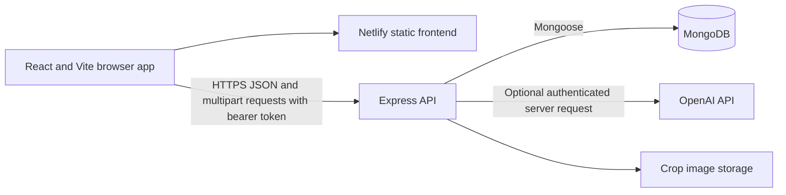

# Smart Crop Planning System

A web application and API for organizing crop records and supporting farm
planning workflows. Farmers can manage crop details, relate recommendations
to farms through the API, and use AI-assisted crop-name autocomplete while
entering a crop.

## Problem Statement

Crop planning involves keeping crop names, growing seasons, soil preferences,
and farm information organized. Scattered records make these details harder
to review and update. This project provides a central application for
maintaining crop records and related planning data.

## Proposed Solution

The application combines a React interface with an Express API and MongoDB
data models. Authenticated users can create, review, edit, and delete crop
records, including optional crop images. The API also supports crop
recommendation records linked to users and farms. An optional server-side
OpenAI integration suggests crop-name completions based on a typed prefix,
season, and soil type.

AI suggestions are autocomplete assistance, not agronomic advice. Users
should validate crop choices against local conditions and expert guidance.

## Technology Stack

- **Frontend:** React, Vite, JavaScript, CSS
- **Backend:** Node.js 22+, Express 5
- **Database:** MongoDB with Mongoose
- **Authentication:** Password hashing with bcryptjs, JWT bearer tokens,
  optional Google OAuth with Passport
- **AI autocomplete:** OpenAI Chat Completions API (optional; configured on
  the backend)
- **Testing:** Jest and Supertest
- **Deployment:** Render Blueprint for the API/application, Netlify for the
  separate frontend, Docker and Docker Compose for local containers
- **API collection:** Bruno

## Architecture Overview



In a combined local or Render deployment, Express serves the Vite build and
the API from the same origin. In a separate Netlify deployment, the frontend
must be built with `VITE_API_URL` set to the backend's public origin. The
OpenAI key remains on the backend; it must never be exposed in a `VITE_*`
variable.

## Key Features

- Register and sign in with email and password; passwords are hashed before
  storage. Google OAuth is optional and requires provider configuration.
- Create, list, update, and delete crop records.
- Upload optional JPEG, PNG, and WebP crop images, limited to 5 MB.
- Request up to five AI crop-name completions when creating a crop. Requests
  are debounced in the frontend and the API requires authentication.
- Create and list crop recommendation records associated with a user and a
  farm through the API.
- Health-check endpoint at `/api/health`.
- Bruno API collection for exploring documented endpoints.

## Repository Structure

```text
.
├── bruno/smart-crop-planning-api/  # Bruno requests and local environment
├── client/                         # React/Vite frontend
│   └── src/
├── models/                         # Mongoose schemas
├── tests/                          # Jest/Supertest API tests
├── .dockerignore
├── .env.example                    # Safe local configuration template
├── Dockerfile                      # Multi-stage production image
├── docker-compose.yml              # Local app + MongoDB
├── netlify.toml                    # Netlify build and SPA routing
├── render.yaml                     # Render web service Blueprint
├── server.js                       # Express app and API routes
└── package.json
```

## Installation Instructions

Requirements: Node.js 22 or later, npm, and MongoDB (local or hosted).

```sh
git clone https://github.com/harirathi2007-crypto/smart-crop-planning.git
cd smart-crop-planning
npm ci
npm --prefix client ci
```

Copy the environment template and edit it for your environment. Do not commit
the populated `.env` file:

```powershell
Copy-Item .env.example .env
notepad .env
```

Replace the example `JWT_SECRET` with a unique random value before running the
server. Startup fails if it is missing. The example value is only a
placeholder and must not be used as a real credential.

For running the Node server directly, Node 22 supports loading the file with
`--env-file`:

```sh
node --env-file=.env server.js
```

Alternatively, export the variables in your shell and run `npm start`.

## Environment Setup

| Variable | Required | Purpose |
|---|---|---|
| `MONGODB_URI` | Optional | MongoDB connection string. Defaults to a local development database; that database must be available. |
| `JWT_SECRET` | Required | Secret used to sign bearer tokens. Use a unique random value; never commit it. The server refuses to start without it. |
| `CLIENT_URL` | Optional | Frontend origin used by Google OAuth redirects. |
| `GOOGLE_CLIENT_ID` | Optional | Google OAuth web client ID. |
| `GOOGLE_CLIENT_SECRET` | Optional | Google OAuth client secret. Keep it private. |
| `GOOGLE_CALLBACK_URL` | Optional | Backend OAuth callback URL. |
| `OPENAI_API_KEY` | Optional | Backend-only key for AI crop-name autocomplete. |
| `OPENAI_MODEL` | Optional | OpenAI model name; defaults to `gpt-4o-mini`. |
| `VITE_API_URL` | For separate frontend hosting | Public backend origin included at frontend build time; omit trailing slash. This is public configuration, not a secret. |
| `PORT` | Usually platform-provided | HTTP port; defaults to `3000`. |

Google sign-in requires all three Google variables and a matching authorized
redirect URI in Google Cloud Console. If any are missing, email/password
authentication remains available and the Google endpoint reports that OAuth
is not configured.

## Running the Project

Build the frontend and start the application from the repository root:

```sh
npm run build
npm start
```

Open `http://localhost:3000`. To run the Vite development server separately,
start the backend first, then run:

```sh
npm --prefix client run dev -- --host 0.0.0.0
```

The Vite development frontend uses `http://localhost:3000` for its API by
default.

### Tests

Run the backend API tests without connecting to MongoDB or calling OpenAI:

```sh
npm test
```

The suite covers health, authentication/validation, protected routes, and
mocked AI provider behavior.

### Docker

With Docker Desktop running, copy `.env.example` to `.env`, replace
`JWT_SECRET` with a unique random secret, and optionally set `OPENAI_API_KEY`.
Then start the application and MongoDB:

```sh
docker compose up --build
```

Open `http://localhost:3000`; verify `http://localhost:3000/api/health`.
Compose persists MongoDB data and uploaded images in named volumes. Stop with
`Ctrl+C`, then run `docker compose down`. `docker compose down -v` also deletes
the local volumes and their data. The Compose app port is bound to localhost
for local demonstration.

## Deployment Links and Status

The repository includes a Render Blueprint in `render.yaml` and a Netlify
build configuration in `netlify.toml`. **Public production access is not
currently verified:**

- **Netlify frontend:** [smart-crop-planning.netlify.app](https://smart-crop-planning.netlify.app/)
  returned HTTP 401 during an unauthenticated check. The
  Netlify project dashboard also showed no project environment variables.
  Treat this as access-restricted until site access settings are reviewed,
  public access is confirmed, and `VITE_API_URL` is configured to a live
  backend URL followed by a new deploy.
- **Render backend:** A live public service URL has not been confirmed, so no
  backend or health-check URL is published here. Once deployed, verify
  `https://<service>.onrender.com/api/health` and replace this note with the
  actual public URLs.

The deployments must be verified before these links can be presented as
working submission links. A successful Netlify deploy preview alone does not
prove that the production site is publicly accessible or connected to the
backend.

### Render setup

Connect this repository to Render as a Blueprint and provide `MONGODB_URI`
when prompted. The Blueprint builds with
`npm ci && npm --prefix client ci && npm --prefix client run build`, starts
with `npm start`, and checks `/api/health`. It generates `JWT_SECRET`. Add
`OPENAI_API_KEY` on the backend if AI autocomplete should be enabled. For
Google OAuth, configure the three Google variables and authorize the callback
URL on the deployed backend.

The default Blueprint uses a free web service. Local disk is not durable
storage on a free instance: use persistent disk or object storage for crop
images. Use a secured MongoDB service and review network access restrictions.

### Netlify setup

Import the Git repository into Netlify. The root `netlify.toml` configures
the build command and `client/dist` publish directory. Set `VITE_API_URL` to
the public Render service origin before building. For Google OAuth, set
Render's `CLIENT_URL` to the Netlify origin. Review Netlify access-control
settings if the site should be publicly reachable.

## Technical Decisions and Known Limitations

- Serving the built client from Express supports a simple single-service
  deployment; a separate Netlify frontend can be configured through
  `VITE_API_URL`.
- JWT bearer authentication protects crop, recommendation, current-user, and
  image endpoints. The frontend stores the session in browser local storage.
- The OpenAI integration is optional and server-side so provider credentials
  are not bundled into frontend assets. Suggestions are not guaranteed
  agronomic recommendations.
- Uploaded images are stored on local disk. Durable storage requires a
  persistent disk or object-storage integration.
- Recommendation APIs and data schemas exist, but the current frontend
  focuses on crop records rather than farm/recommendation management screens.
- Google OAuth requires external Google Cloud credentials and redirect-URI
  setup.
- Public frontend access currently returns HTTP 401; the backend URL,
  database connection, login flow, and end-to-end workflows have not been
  verified against a publicly accessible production deployment.
- Weather and market data models exist, but external integrations and
  corresponding application workflows remain future work.

## Future Improvements

- Complete public access configuration and verify the full deployed
  frontend-to-API-to-database workflow.
- Add farm management and interactive recommendation screens.
- Add persistent object storage for crop images.
- Integrate validated weather, soil, and market-price data into explainable
  recommendations.
- Add rate limiting, stricter production CORS rules, and broader integration
  tests.

## Deployment Walkthrough Video

**Video link: pending recording and upload.** After recording a 5–8 minute
walkthrough, replace this line with a Google Drive link that is accessible to
reviewers. Show the live app only after public access and backend connectivity
have been verified. Explain the repository layout, stack, architecture,
technical trade-offs, current deployment limitations, and lessons learned.

## Contributors

- Hariharan S — project owner and maintainer. See the Git history and pull
  requests for the implementation record.
